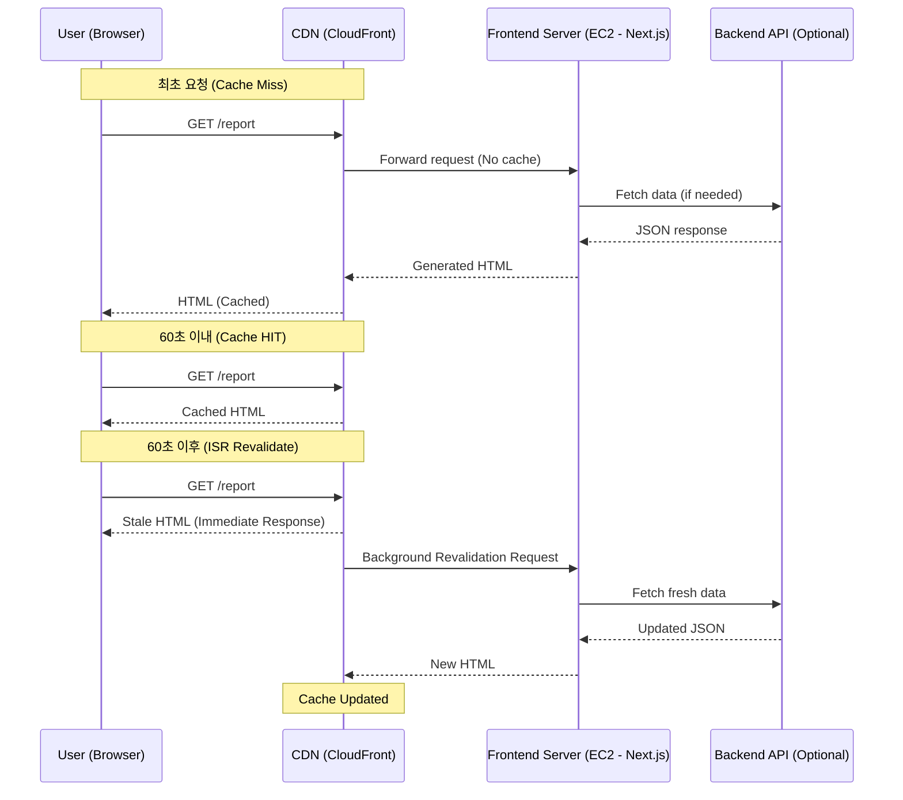

# 렌더링 전략

## 1. 배경과 맥락

> <span color="gray">어떤 이유 때문에 필요 했는가?</span>

- NextJS로 프론트엔드 개발을 하면서 다양한 렌더링을 마주친다.
  - 각 렌더링이 어떤 특징을 가졌고 차이점이 있는지 알아보고자 합니다.
  - 어떤 전략을 어떤 상황에서 써야하는지 알아보고자합니다.

---

## 2. 기술 키워드

> <span color="gray">키워드 위주로 적고 말로 설명하는 연습을 합시다. </span>

<callout color="yellow_bg">
### 내가 생각하기

<ul>
<li>
기본적인 순서 : <b>소스 코드(JS번들) → 빌드 → (산출물) → CDN → 배포</b>

<p>
앞이 되어있지 않으면 뒤가 되지 않음 즉, 빌드가 되지 않으면 CDN이 되지 않는다.
</p>
</li>
<li>
<b><span color="blue">SSR </span></b><span color="blue">:</span> 요청이 올 때마다 프론트 <b><span color="brown_bg">서버</span></b>에서 HTML을 생성하여 응답하기때문에, JS요청을 하여 그림을 그리기 때문에 꼭 서버가 필요하다.

- <b>클라이언트  ↔ 서버 </b>: 요청올 때마다 서버에서 즉석으로 HTML을 그려줌.

</li>
<li>
<b><span color="blue">CSR : </span></b>서버에서 빈페이지 HTML JS번들을 가지고 있고 브라우저에서 요청을 보내면 서버에게 받은JS번들과 HTML 을 브라우저에서 조합한다.

- <b>클라이언트 ↔ 서버 : </b>빈 HTML + JS 수신 후, 클라이언트에서 API 요청 및 DOM 생성

</li>
<li>
<b><span color="blue">SSG :</span></b><span color="blue"> </span>빌드시 생성된 정적 HTML을 CDN에서 갖고 있다.

- <b>클라이언트 ↔ CDN :</b> 캐시된 CDN 받음

</li>
<li>
<b><span color="blue">ISR :</span></b> 정적 페이지로 갖고 있지만, 프론트 서버에서 revalidate 조건이 충족되면 새로운 데이터를 받아서 다시 HTML을 그려준다.

<ul>
<li>
<b>클라이언트 ↔ CDN : </b>캐시된 CDN 받음
</li>
<li>
revalidate 조건이 충족되면 새로 HTML을 발급받아야해서 프론트 서버가 살아있어야됨.
</li>
</ul>
</li>
</ul>
</callout>

## 2. 동작 방식 비교 (렌더링 타이밍)

### CSR

HTML을 받고, 브라우저에서 JS가 데이터를 fetch하여 렌더링한다.

```txt
브라우저 요청 발생
 → CDN 또는 오리진 서버에서 HTML, CSS, JS 번들 등 리소스를 받아옴
 → 브라우저가 JS 실행
 → JS가 API 서버에 데이터 요청(fetch)
 → 데이터를 받아와서 DOM을 동적으로 생성
 → 최종 화면이 브라우저에서 완성됨
```

<quote>
<b>어떤 경우에 사용하면 좋을까요?</b>

1. 사용자 인터렉션이 필요할때 <br />→ 화면 자체를 JS로 동적으로 변화시켜주기 때문에 화면에서 동적인 변화가 필요할때
</quote>

### SSR

요청이 들어올 때마다 서버에서 HTML을 생성해 반환한다.

```txt
브라우저 요청 발생
 → 서버에서 (서버컴포넌트 실행 : fetch 실행)데이터 조회
 → HTML 생성
 → 클라이언트 응답
 → Hydration(서버컴포넌트에서 우선 실행된 후에, 클라이언트 컴포넌트의 참조위치를 함께 가져와서 브라우저에서 useEffect 또는 useState를 동작한다.)

```

- 매 요청마다 서버 연산(렌더링) → 항상 최신 데이터 보장

1. <b>항상 먼저 </b><b><span color="red">서버가 실행</span></b><b>되어야 모든 것이 시작됨.</b>
   <p>
   → 구조 자체가 api요청도 서버 컴포넌트(RSC)\[use Client X\]에서 실행되기 때문
   </p>

   - <code>fetch(..., { cache: 'no-store' })</code>

   <p>
    → 저장되지 않기 때문에 no store
   </p>

<quote>
<b>어떤 경우에 사용하면 좋을까요?</b>

1. <b>요청마다 데이터가 달라야 할 때</b>
   <p>
   → 항상 서버에 있는 데이터에 인하기 때문에 서버 데이터에 의존하는 경우가 많을 때
   </p>

   - 사용자 세션 기반 데이터
   - 항상 최신 데이터 필요
   - SEO의 기능 필요 시
</quote>

### SSG

빌드 시점에 HTML을 생성해 CDN에 배포한다.

```txt
빌드 시
 → 모든 페이지 HTML 생성
 → CDN에 배포
 → 요청 시 즉시 응답

```

- 빌드 타임 정적 생성 → 런타임 서버 연산 없음
- 데이터 변경 시<b> 재빌드 필요</b>
- <b><span color="red">스냅샷 방식</span></b>
  - 특정 시점에 데이터를 스냅샷처럼 찍어서 <b>정적페이지</b>로 만들어두는 방식이다.
  - 기본 <code>fetch</code> 캐시 (<code>force-cache</code>)

<quote>
<b>어떤 경우에 사용하면 좋을까요?</b>

1. <b>데이터가 거의 변하지 않을 때</b>
   <p>
   → 데이터가 변경시에 재빌드를 해야하기 때문에 자주 변경되지 않는 데이터를 가진 환경에 적합
   </p>

   - 마케팅 페이지
   - 회사 소개
   - 블로그 글
2. <b>트래픽이 매우 많고 서버 부하를 줄이고 싶을 때</b>
   <p>
   → CDN에서 가져오기 때문에 origin 서버에 부하가 없음.
   </p>
</quote>

### ISR

SSG처럼 정적으로 제공하되, 일정 시간 이후 요청이 오면 서버가 다시 HTML을 생성한다.

```txt
빌드 시
 → 초기 HTML 생성
 → CDN 배포

요청 중
 → revalidate 시간 초과 시 (60')
 → 서버에서 백그라운드 재생성
 → 이후 요청부터 새 HTML 제공

```

- 첫 응답은 정적 페이지
- 갱신은 서버가 점진적으로 수행
  - revalidate → <b>(revalidate)초 지나서 새 빌드된 html이 CDN에 등록되어 있음 + 데이터가 stale 상태 </b>+   → 어떤 트리거에 의해 (예 : refetchwindowfocus : true) 데이터를 재요청 보내어서 다시 빌드 하도록.

<b>ISR(Incremental Static Regeneration)은:</b>

- 정적 HTML을 CDN에 캐시해 두되, <b>갱신 시점</b>에는 서버가 다시 HTML을 생성하는 방식

> <b>어떤 경우에 사용하면 좋을까요?<br />1. 자주 바뀌지만 실시간성일 필요까지는 없을 때<br />2. SEO도 중요하고 트래픽도 많은 경우</b><br />→ 때문에 MOLIP에서는 <b><span color="blue">public 비로그인 분기 회고 목록 페이지</span></b>에서 사용하는 렌더링 전략

---

<h2>
 3\. 고민했던 내용과 인사이트
</h2>

### ❓ js번들은 동적 파일 아닌가요?

<b>정적과 동적 차이</b>

<ul>
<li>
<b>정적 : </b>빌드 - 한번 생성되면 변하지 않는다.
</li>
<li>
<b>동적 : </b>요청 시점에 내용이 바뀔수있음.

<p>
→ DB데이터에 따라 실시간으로 데이터가 달라짐.
</p>
</li>
</ul>

> CDN 입장에서는 정적 리소스지만 <b>브라우저(엔진)에서 실행되면 동작함</b>

→ 정적 리소스 html, css, js 번들을 받아와서 정적 리소스 html에 js를 실행하니 동적인 페이지가 된 것.

```javascript
// app.js (JS 번들, 정적 파일이지만 실행되면 동작함)

import { useEffect, useState } from "react";

export function ChatRoom() {
  const [room, setRoom] = useState(null);

  useEffect(() => {
    fetch("/api/chat/room")
      .then(res => res.json())
      .then(setRoom);
  }, []);

  if (!room) return <div>로딩중...</div>;

  return (
    <div>
      <h1>채팅방</h1>
      <p>방 ID: {room.roomId}</p>
    </div>
  );
}

```

- <code>app.js</code> 파일 <b>자체는 정적</b>
- 하지만 <b>실행되면</b>
  - API 요청 발생
  - DB 조회
  - DOM 변경
- HTML 파일은 <b>절대 바뀌지 않음</b>
- <b>브라우저 메모리 안에서 화면만 바뀜</b>

### ❓ 프론트 서버의 주체가 CDN이라면 주기적으로 갱신되는 ISR은 어떤 흐름일까?

<ul>
<li>
<b><u>ISR</u></b><u> ⇒</u><b><u> 특정 주기 마다 빌드하는 렌더링 전략</u></b>
</li>
<li>
인프라 측면에서는 <b>프론트 서버(nextJs, EC2)</b>가 ISR의 백엔드<b> 역할</b>(요청 시 리소스 제공)을 하고, 실제로 사용자에게 정적으로 제공되는 부분은 CDN이 맡는 구조입니다.

그리고 ISR이 revalidate 타이밍에 도달하면 EC2에 있는 프론트 서버가 새로운 HTML을 생성해서 다시 CDN에 반영하는 흐름

> <b>키워드 요약</b>

- EC2의 Next.js 서버 = ISR 실행 주체
- CDN = 캐시 및 정적 응답 전달 계층
- ISR revalidate 시 EC2가 새 HTML을 생성하고 CDN 캐시를 갱신한다.
</li>
</ul>


